```mermaid
graph TD
  PM[사진측량 1858]
  BA[Bundle Adjustment<br/>Brown 1958]
  SfM[Photo Tourism 2006]
  COLMAP[COLMAP 2016]

  SC[Smith-Self-Cheeseman 1988]
  Mono[MonoSLAM 2003]
  PTAM[PTAM 2007]
  ORB[ORB-SLAM 2015]
  ORB3[ORB-SLAM3 2021]

  LSD[LSD-SLAM 2014]
  DSO[DSO 2018]
  VIDSO[VI-DSO 2018]

  LM[Lu-Milios 1997]
  FG[Factor Graph<br/>Dellaert 2000s]
  iSAM[iSAM 2008]
  iSAM2[iSAM2 2012]
  g2o[g2o 2011]

  Forster[Preintegration<br/>Forster 2015]
  VINS[VINS-Mono 2018]

  Kinect[KinectFusion 2011]
  Elastic[ElasticFusion 2015]

  SESync[SE-Sync 2019]
  TEASER[TEASER 2021]

  LOAM[LOAM 2014]
  FAST[FAST-LIO 2021]

  NeRF[NeRF 2020]
  iMAP[iMAP 2021]
  NICE[NICE-SLAM 2022]

  GS3D[3DGS 2023]
  Spla[SplaTAM 2024]
  MonoGS[MonoGS 2024]

  DROID[DROID-SLAM 2021]
  DPV[DPV-SLAM 2024]

  DUSt3R[DUSt3R 2024]
  MASt[MASt3R 2024]
  VGGT[VGGT 2025]
  MASlam[MASt3R-SLAM 2025]

  Kimera[Kimera 2020]
  Hydra[Hydra 2022]
  Clio[Clio 2024]

  PM --> BA --> SfM --> COLMAP
  SC --> Mono --> PTAM --> ORB --> ORB3
  PTAM -.-> LSD --> DSO --> VIDSO
  LM --> FG --> iSAM --> iSAM2
  FG --> g2o
  FG -.-> SESync
  Forster --> VINS
  Forster --> ORB3
  Forster --> VIDSO
  Kinect --> Elastic
  LOAM -.-> FAST
  NeRF --> iMAP --> NICE
  GS3D --> Spla
  GS3D --> MonoGS
  DROID --> DPV
  COLMAP -.-> DUSt3R --> MASt
  DUSt3R -.-> VGGT
  MASt --> MASlam
  Kimera --> Hydra --> Clio

  click PM "#chapter-1" "1장 사진측량"
  click BA "#chapter-1" "1장 Bundle Adjustment"
  click SfM "#chapter-3" "3장 Structure from Motion"
  click COLMAP "#chapter-3" "3장 SfM — COLMAP"
  click SC "#chapter-4" "4장 EKF-SLAM — Smith-Self-Cheeseman"
  click Mono "#chapter-5" "5장 MonoSLAM·PTAM"
  click PTAM "#chapter-5" "5장 MonoSLAM·PTAM"
  click ORB "#chapter-8" "8장 ORB-SLAM 계열"
  click ORB3 "#chapter-8" "8장 ORB-SLAM3"
  click LSD "#chapter-11" "11장 Direct Methods — LSD-SLAM"
  click DSO "#chapter-11" "11장 Direct Methods — DSO"
  click VIDSO "#chapter-11" "11장 Direct Methods — VI-DSO"
  click LM "#chapter-6" "6장 Graph SLAM — Lu-Milios"
  click FG "#chapter-6" "6장 Graph SLAM — Factor Graph"
  click iSAM "#chapter-6" "6장 Graph SLAM — iSAM"
  click iSAM2 "#chapter-6" "6장 Graph SLAM — iSAM2"
  click g2o "#chapter-6" "6장 Graph SLAM — g2o"
  click Forster "#chapter-9" "9장 IMU Preintegration"
  click VINS "#chapter-9" "9장 — VINS-Mono"
  click Kinect "#chapter-12" "12장 RGB-D — KinectFusion"
  click Elastic "#chapter-12" "12장 RGB-D — ElasticFusion"
  click SESync "#chapter-7" "7장 Certifiable — SE-Sync"
  click TEASER "#chapter-7" "7장 Certifiable — TEASER"
  click LOAM "#chapter-21" "21장 LiDAR — LOAM"
  click FAST "#chapter-21" "21장 LiDAR — FAST-LIO"
  click NeRF "#chapter-17" "17장 NeRF-SLAM"
  click iMAP "#chapter-17" "17장 NeRF-SLAM — iMAP"
  click NICE "#chapter-17" "17장 NeRF-SLAM — NICE-SLAM"
  click GS3D "#chapter-18" "18장 Gaussian Splatting"
  click Spla "#chapter-18" "18장 — SplaTAM"
  click MonoGS "#chapter-18" "18장 — MonoGS"
  click DROID "#chapter-16" "16장 Hybrid — DROID-SLAM"
  click DPV "#chapter-16" "16장 — DPV-SLAM"
  click DUSt3R "#chapter-20" "20장 Foundation 3D — DUSt3R"
  click MASt "#chapter-20" "20장 — MASt3R"
  click VGGT "#chapter-20" "20장 — VGGT"
  click MASlam "#chapter-20" "20장 — MASt3R-SLAM"
  click Kimera "#chapter-23" "23장 §23.7 — Kimera"
  click Hydra "#chapter-20" "20장 §20.6 Semantic Foundation"
  click Clio "#chapter-20" "20장 §20.6 — Clio"
```

# Ch.19 — 오늘의 지도와 내일의 공란

2026년에는 AR 화면에 띄운 물체가 벽에 붙은 채 흔들리지 않는다. 실내 배송 로봇은 지도 없이 주방과 회의실을 구분하고, DUSt3R 계열 모델에 사진 몇 장을 넣으면 몇 초 만에 3D 구조가 나온다. SLAM이 다 풀렸다는 인식은 이런 장면에서 나온다.

풀린 것은 2003년 무렵의 문제다. 장면은 정적이고, 조명은 일정하고, 공간은 좁다고 가정하면 단안 카메라의 기하만으로 문제를 풀 수 있었다. 이 가정 아래서 EKF가 돌아갔고, graph SLAM이 루프를 닫았고, ORB-SLAM이 keyframe을 관리했다.

각 방법이 풀었다고 한 문제 바로 옆에 아직 풀리지 않은 문제가 있다. 앞 장들에서 다룬 이런 문제를 모아 보면 서로 다른 방법이 같은 제약에 걸려 있다.

---

## 19.1 조명과 환경 변화: 카메라 측광 모델의 한계

Visual SLAM을 실외에서 쓰기 시작한 뒤로 조명과 날씨 변화가 계속 문제가 됐다. 실제 조명과 날씨는 카메라 측광 모델(photometric model)이 가정하는 범위를 자주 벗어났다.

학습한 descriptor는 훈련 도메인에서는 ORB보다 낫다. 수중, 열화상, 저조도 영상에서는 결과가 들쭉날쭉하고, 어느 쪽이 나은지는 아직 가려지지 않았다(Ch.2 §2.7 참조). Ch.5에서 다룬, 어둡거나 움직임이 많은 장면에서 추적이 끊기는 문제도 그대로다. 2007년 PTAM은 논문 제목에 "Small AR Workspaces"를 넣어 쓰는 범위를 좁은 작업 공간으로 한정했다(Ch.5 참조).

Direct method에서는 이 문제가 방법의 바탕에 닿는다. direct method는 같은 점이 어느 프레임에서나 같은 밝기로 보인다고 가정한다(brightness constancy). 자동 노출이 바뀌거나, 역광이 들거나, 터널에서 밖으로 나오면 이 가정이 바로 깨진다. Bergmann 등의 online photometric calibration은 노출 시간, response function, vignetting을 direct VO와 나란히 실시간으로 추정한다(Ch.8 §🧭 참조). Place recognition도 같은 문제를 10년 넘게 안고 있다. [Nordland](https://nikosuenderhauf.github.io/projects/placerecognition/)와 [Oxford RobotCar](https://robotcar-dataset.robots.ox.ac.uk/)처럼 계절과 조명이 크게 바뀌는 데이터에서 [DINOv2](https://arxiv.org/abs/2304.07193) 기반 방법이 격차를 줄였다(Ch.10 §10.7 참조).

ORB-SLAM에서 지도를 오래 다시 쓰는 일도 같은 문제에 막힌다. ORB-SLAM3의 Atlas로 여러 지도를 함께 관리할 수 있게 됐다. 그래도 아침에 만든 지도로 저녁에 같은 장소를 알아보려 할 때 조명이 크게 다르면 실패할 수 있다(Ch.7 §🧭 참조).

---

## 19.2 정적 세계 가정: 가장 오래된 단순화의 한계

SLAM은 오래전부터 세계가 움직이지 않는다고 가정했다(static world assumption). 여러 방법이 이 가정에서 한계를 만났다.

COLMAP 같은 SfM 파이프라인은 정적 장면을 가정해서 움직이는 물체에 약하다. KinectFusion부터 BundleFusion까지 RGB-D dense SLAM도 모두 장면이 정적이라고 가정한다. DynaSLAM과 MaskFusion은 segmentation을 붙여 움직이는 물체를 다루려 했다. 계산 비용과 robustness를 함께 맞추는 일은 남은 과제다(Ch.9 §🧭 참조).

Self-supervised monocular depth는 움직이는 물체를 mask로 가려 학습에서 뺀다(Ch.11 §🧭 참조). GS-SLAM, SplaTAM, MonoGS 같은 초기 3DGS SLAM도 정적 세계를 가정했다(Ch.15 §🧭 참조). LiDAR SLAM에도 같은 문제가 있다. LOAM이 future work로 밝힌 과제와 별개로 움직이는 물체를 다루는 문제가 남아 있다(Ch.17 §🧭 참조).

오랜 시간에 걸친 변화와 변형(deformation)도 같은 문제에 속한다. 로봇이 다시 찾은 방에서 전에 본 물체가 보이지 않으면, 물체가 정말 없어졌는지(evidence of absence) 그 자리를 제대로 보지 못했을 뿐인지(absence of evidence) 가려야 한다. SLAM Handbook 15장은 이 문제를 change detection(변화 감지)의 과제로 다루고, Khronos가 loop closure 뒤에 변화 감지 단계를 돌려 둘을 가린다고 설명한다. [Schmid 등의 Panoptic Multi-TSDF](https://doi.org/10.1109/ICRA46639.2022.9811877)(ICRA 2022)는 물체마다 따로 submap을 두고 물체 단위로 변화를 추론해 오래 쓰는 지도를 최신 상태로 유지했다. 변형하는 장면에서는 카메라의 rigid motion과 물체의 rigid motion을 나누기 어렵다. Handbook은 이것을 **Floating Map Ambiguity**라고 부르고, 물체의 변위에 prior를 주어 둘을 나눈다고 설명한다. Handbook §15.5는 카메라 궤적과 지도의 변형을 둘 다 정확히 추정할 수 있는 조건을 열린 질문으로 남겼다. Khronos는 RGB-D 입력으로 이 변화 감지를 온라인으로 돌렸지만, 변형하는 장면은 다루지 않았다. 최소침습수술(MIS)용 SLAM에서는 NR-SLAM이 생체 내시경 영상으로 평가됐지만, 논문 스스로 깊이 불연속과 강한 변형이 함께 있는 장면에서는 지도를 만들고 넓히기 어렵다고 밝혔다(Ch.15b 참조).

---

## 19.3 Scale과 표현 메모리: 크기가 달라지면 문제가 달라진다

SLAM 시스템이 방 한 칸에서 건물로, 건물에서 도시로 커질 때마다 같은 문제가 모양을 바꿔 다시 나왔다.

단안 카메라만으로는 크기(scale)를 정할 수 없다는 사실은 1980년대 SfM 이론에서 이미 밝혀졌다. 단안 영상의 투영 기하만으로 얻은 궤적과 장면은 어떤 배율을 곱해도 관측과 똑같이 맞는다. metric scale을 정하려면 IMU나 depth 같은 정보가 더 필요하다(Ch.5 §🧭 참조). Ch.11의 monocular depth에서도 같은 문제가 나온다. [Metric3D v2](https://arxiv.org/abs/2404.15506)는 카메라 모델 차이를 canonical camera space로 바꾸어 metric depth를 냈고, [Depth Anything V2](https://arxiv.org/abs/2406.09414)는 metric depth label로 fine-tuning한 모델을 내놓았다. 스마트폰, CCTV, 기록 보관 영상, 위성 영상처럼 intrinsic을 모르는 영상에서 카메라에 상관없이 metric depth를 내는 일은 아직 풀리지 않았다(Ch.11 §🧭 참조).

TSDF 방식에서는 메모리 문제가 표현의 한계로 나타났다. [Voxblox](https://arxiv.org/abs/1611.03631)와 [OctoMap](https://octomap.github.io/)으로 비용은 줄었다. 그래도 dense 표현의 메모리는 지도 범위와 voxel 해상도에 따라 빠르게 늘어난다. 영역마다 해상도를 달리하는 wavemap 같은 다해상도 구조도 나왔다(Ch.9 §🧭 참조). NeRF-SLAM도 같은 한계에 막혔고, 도시 규모는 아직 풀리지 않았다(Ch.14 §🧭 참조). Gaussian Splatting에서도 장면 범위와 세부가 커지면 필요한 Gaussian 수가 늘어난다(Ch.15 §🧭 참조). Foundation 3D에서는 이 문제가 transformer의 계산 구조에서 온다. 모든 image token 사이에 attention을 계산하면 메모리가 token 수의 제곱으로 늘어서 긴 시퀀스를 다루기 어렵다. Spann3R의 incremental 방식은 부분적인 답이다(Ch.16 §🧭 참조).

크기 문제는 **데이터 이동 비용**으로도 나타난다. 전력을 많이 먹는 것은 프로세서와 메모리 사이에서 비트를 옮기는 물리적 비용이다. Davison은 Handbook Ch.18 §18.8에서 12번째 SLAM 지표로 "on-device data movement, measured in bits × millimetres"를 제안한다(p.547). Handbook Ch.16의 식들도 표현마다 복잡도를 나눠 적는다. label마다 따로 둔 flat voxel map은 $O(L\cdot V/\delta^3)$이다(Eq. 16.34). metric-semantic hierarchy는 $O(V/\delta^3+N_\text{objects}+N_\text{rooms}+\cdots)$이다(Eq. 16.35). topological 3D scene graph처럼 기하 층을 더 작게 표현하면 $O(N_\text{sub-sym}+N_\text{objects}+N_\text{rooms}+\cdots)$가 된다(Eq. 16.36). 마지막 단계에서는 기하 표현이 바뀌어 원래 voxel 지도의 정보를 일부 잃는다.

---

## 19.4 학습 기반 시스템의 불확실성 calibration

Ch.4에서 다룬 Julier와 Uhlmann의 EKF inconsistency 분석 이후, SLAM 시스템이 자기가 어디 있는지 모른다는 사실을 얼마나 정확히 아는지는 이 분야의 질문으로 남아 있다.

비가우시안 불확실성은 EKF의 핵심 가정과 부딪힌다. 실제 센서 오차는 봉우리가 여럿이거나(multi-modal) 꼬리가 두꺼운(heavy-tail) 경우가 흔하다. Stein particle, normalizing flow, learned uncertainty가 시도되고 있고, 실시간 시스템에서는 아직 검증되지 않았다(Ch.4 §4.8 참조). Graph SLAM에서 환경과 센서에 맞는 robust kernel을 미리 정하는 일도 남은 과제다(Ch.6 §🧭 참조). [Ch.6b](chapter_06b_certifiable.md)의 tightness 경계도 같은 문제다. SE-Sync가 정확한 해를 찾는다는 보장은 노이즈가 $\beta$ 이하라는 충분조건으로 주어진다. 실제 문제에서 $\beta$를 미리 계산하는 일, certifiable 방법을 visual SLAM과 VIO로 넓히는 일, 새 측정이 들어올 때마다 SDP를 다시 풀어 certificate를 갱신하는 online certification은 모두 아직 남아 있다.

학습 기반 방법에서는 문제가 더 어렵다. Bayesian PoseNet이 불확실성을 추정하려 한 뒤로도, learned uncertainty가 OOD(훈련 분포 밖) 입력에서 calibrated인지는 아직 확인되지 않았다(Ch.12 §🧭 참조). DROID-SLAM 계열에서 보았듯 learned prior는 훈련 도메인 밖에서 성능이 떨어져도 얼마나 떨어졌는지 겉으로 드러나지 않을 수 있고, 학습한 모델은 그럴듯한 모양으로 실패하기도 한다. geometric 방법에도 잘못된 지역해나 지나친 확신처럼 드러나지 않는 실패가 있다. [TartanAir](https://arxiv.org/abs/2003.14338) 같은 합성 데이터를 써도 sim-to-real gap이 남는다(Ch.13 §🧭 참조).

Foundation 3D에서는 이 문제가 loop closure를 어떻게 정의할지의 문제로 이어진다. DUSt3R 계열에서 pointmap 기반 교정을 지도 전체에 퍼뜨리는 일을 MASt3R-SLAM은 기존 방식으로 처리한다. 이것이 원리적인 해법인지는 불확실하다(Ch.16 §🧭 참조).

Davison은 Handbook Ch.18에서 문제를 다시 세운다. *"100장으로 3D 모델을 만든 네트워크에 이미지 1장이 추가되면 전체를 다시 돌려야 하는가"*(p.528). 장기 표현과 fusion이 필요하다고 보면 probabilistic state estimation과 modular scene representation이 필요해진다. 그가 대안으로 든 [GBP Learning](https://arxiv.org/abs/2311.14649)(Nabarro et al., ICML 2024)은 신경망 weight를 factor graph의 random variable로 넣어 *"training time"*과 *"test time"*의 구분을 없애는 방향이다(§18.7, pp.543–545). 이 방향이 문제를 원리적으로 푸는지는 아직 알 수 없다.

---

## 19.5 센서 융합과 새 모달리티

Visual SLAM과 LiDAR SLAM은 같은 시기에 같은 문제를 다른 센서로 풀었다. 둘을 합치려는 시도가 이어졌지만 하나의 방법으로 모이지는 않았다.

LVI-SAM은 visual-inertial subsystem과 lidar-inertial subsystem을 factor graph로 묶었고, 저자들은 이를 tightly coupled 시스템이라고 불렀다. 두 subsystem은 서로 정보를 주고받으면서도 필요하면 따로 돌 수 있게 짜여 있다. 두 센서를 한 추정기에서 함께 다루는 표준 설계를 정하는 일은 남은 과제다(Ch.17 §🧭 참조). solid-state LiDAR가 널리 쓰이면서 알고리즘이 따라가지 못한 부분도 있다. LOAM은 360°로 도는 scan line을 가정했다. solid-state LiDAR는 시야(FoV)가 좁고 스캔 패턴이 반복되지 않아 관측 조건이 다르다. FAST-LIO2와 Livox LOAM이 일부를 다루지만, 여러 센서 종류에 두루 맞는 방법을 만드는 일은 아직 끝나지 않았다(Ch.17 §🧭 참조).

wide-baseline 매칭에도 남은 문제가 있다. 시점이 크게 바뀌면 Harris나 ORB 같은 hand-crafted local feature의 성능이 떨어진다. 몇 도부터 떨어지는지는 데이터마다 다르다. DUSt3R에는 전통적인 sparse matching 단계가 없다. 이것이 descriptor 문제를 푼 것인지는 아직 판단하기 이르다(Ch.2 §2.7 참조). Place recognition과 metric localization도 파이프라인에서 따로 떨어져 있다. 2023–2025년에 두 과정을 하나의 표현으로 합치려는 연구가 나왔지만, 위치 정밀도와 처리 속도를 함께 얻는 문제가 남았다(Ch.10 §10.7 참조).

Event camera는 새 모달리티가 나왔을 때 알고리즘이 얼마나 늦게 따라오는지 보여 준다. 2017년 Samsung의 640×480 DVS와 2021년 Sony·Prophesee의 1280×720 센서처럼 해상도가 높은 event camera가 나왔다(Ch.18 §18.6 참조). frame 기반 pipeline과 합치는 문제, event 표현, 실제 환경 benchmark는 아직 함께 진행 중이다(Ch.18 §🧭 참조).

이 책이 다루지 않은 모달리티도 있다. **4D imaging radar**와 **legged/proprioceptive SLAM**이다. Radar는 안개나 비처럼 카메라와 LiDAR가 함께 약해지는 조건을 보완한다. Oxford Radar RobotCar(2020), nuScenes의 radar 채널, Arbe와 Mobileye 등의 4D imaging radar 개발로 radar는 자율주행 연구와 제품 개발의 한 축이 됐다. Legged SLAM은 2020년대에 ANYmal, Spot, Unitree가 실외에 배치되면서 운동학(kinematic) prior와 접촉(contact) prior를 융합하는 별도의 연구 흐름이 됐다. 두 분야 모두 visual, LiDAR, foundation 3D와 출발점도 benchmark도 달라서 각각 따로 역사를 쓸 만한 크기다.

---

## 19.6 알고리즘 구조를 하드웨어에 맞추기

Davison은 Handbook Ch.18에서 알고리즘의 그래프 구조를 실리콘의 그래프 구조에 맞추는 문제를 앞에 내세운다.

Handbook은 프로세서가 해마다 빨라진다는 전제를 *"this has stopped being true"*라고 정리하고, 단일 코어 clock speed가 약 4 GHz에서 더 오르지 않게 됐다고 설명한다(Handbook Ch.18, pp.528–529). 반면 몸에 걸치는 Spatial AI 기기는 안경 한 짝 크기(65 g, 1 W 미만)에 맞춰야 한다(p.522). Handbook은 이 차이 때문에 분야가 **heterogeneous·specialized·parallel** 아키텍처로 갈 수밖에 없다고 본다.

Handbook은 서로 다른 실리콘 사례를 나란히 든다. [Apple Vision Pro의 R1](https://www.apple.com/uk/newsroom/2023/06/introducing-apple-vision-pro/)(2023)은 카메라와 센서의 새 이미지를 12 ms 안에 디스플레이로 보내도록 설계됐다. [Meta Aria Gen 2](https://ai.meta.com/blog/aria-gen-2-research-glasses-under-the-hood-reality-labs/)(2025)는 기기 안의 machine perception에 전용 coprocessor를 쓴다. Graphcore IPU는 칩 하나에 저마다 메모리를 가진 코어 1,216개를 두고, 코어끼리 메시지를 주고받는다. Manchester 대학의 [SCAMP5](https://personalpages.manchester.ac.uk/staff/p.dudek/papers/carey-iscas2013.pdf)는 256×256 픽셀마다 처리기를 두고 1.2 W로 동작한다. [SpiNNaker](https://apt.cs.manchester.ac.uk/projects/SpiNNaker/)는 ARM 코어를 최대 100만 개까지 묶는 neuromorphic 구조다. 칩마다 맞는 graph topology가 다르다. 어떤 알고리즘을 어느 실리콘에 어떻게 올릴지는 남은 과제다.

Davison이 후기에 연구한 **Gaussian Belief Propagation(GBP)**은 이 문제를 다룬다. Ortiz, Pupilli, Leutenegger, Davison은 [Bundle Adjustment on a Graph Processor](https://arxiv.org/abs/2003.03134)(CVPR 2020)에서 IPU 코어 1,216개로 GBP를 돌려 keyframe 125개와 점 1,919개로 된 실제 bundle adjustment 문제를 40 ms 안에 풀었다. 같은 문제를 CPU의 Ceres로 풀면 1,450 ms가 걸렸다. Murai 등의 [Robot Web](https://arxiv.org/abs/2202.03314)(IEEE TRO 2024)에서는 로봇마다 factor graph의 자기 조각을 맡고 메시지를 주고받으며 비동기 GBP로 위치를 추정했고, 시뮬레이션에서 최대 1,000대까지 시험했다. Davison은 *"We must get away from the idea that a 'god's eye view' of the whole structure of the graph will ever be available"*라고 쓴다(Handbook Ch.18, p.541). Factor graph를 기본 표현으로 두고, 전체 posterior를 한 번에 구하는 일은 포기한다. 메시지는 그래프 위를 "bubble"하듯 퍼지며 국소적으로 수렴한다. MASt3R-SLAM 같은 transformer 기반 시스템은 backend에서 GBP 대신 그래프 전체를 한 번에 푸는 2차 global optimization을 쓴다.

Davison이 제안한 12개 지표 가운데 11번 "power usage"와 12번 "on-device data movement"는 하드웨어 쪽 지표다(§18.8, p.547). 정확도와 함께 전력, 그리고 장치 안에서 옮기는 데이터의 비트 수와 거리로 시스템을 평가하자는 제안이다. TUM, KITTI, EuRoC 같은 주요 benchmark가 이 지표를 받아들일지는 정해지지 않았다. 알고리즘을 중심으로 쓴 이 책도 이 부분은 다루지 않았다.

---

## 19.7 Semantic 표현과 Open-World

[Ch.18 §18.4](chapter_18_dead_ends.md#184-semantic-slam--사물을-landmark로-쓰는-방식)는 semantic이 landmark 자리에서 밀려났다고 썼다. 좁은 의미로는 맞는 말이다. ORB-SLAM3와 MASt3R-SLAM의 지도는 point로 이루어진다. 같은 시기에 semantic은 지도의 위층으로 옮겨 가 실제 성과를 냈다.

metric-semantic mesh를 실시간으로 만든 [Kimera](https://doi.org/10.1109/ICRA40945.2020.9196885)(2020)와 scene graph를 계층으로 나누어 실시간으로 만든 [Hydra](https://doi.org/10.15607/RSS.2022.XVIII.050)(2022)는 Ch.18 §18.4에서 다뤘다. Handbook Ch.16은 Hydra를 *"first online system to produce fully hierarchical scene graphs that included objects, places, and rooms"*라고 부른다(§16.4.2). 그 위에 foundation feature가 얹혔다. [ConceptFusion](https://arxiv.org/abs/2302.07241)과 [VLMaps](https://arxiv.org/abs/2210.05714)(2023)는 CLIP feature를 dense map에 붙였다. [ConceptGraphs](https://doi.org/10.1109/ICRA57147.2024.10610243)(2024)는 open-vocabulary object node에, [Clio](https://doi.org/10.1109/LRA.2024.3451395)(2024)는 task-driven hierarchy에 붙였다. [LERF](https://arxiv.org/abs/2303.09553)와 [LangSplat](https://arxiv.org/abs/2312.16084)은 radiance field와 Gaussian splatting에 CLIP feature를 실었다.

이 흐름에서 새로 생긴 문제도 많다. Handbook Ch.16 저자들은 *"performing uncertainty quantification in hierarchical representations mixing discrete and continuous variables is still a largely unexplored problem"*이라고 쓴다(p.488). 사물 category나 방 ID 같은 이산 변수와 pose나 surface 같은 연속 변수가 섞인 그래프에서 불확실성을 어떻게 전파할지는 아직 거의 연구되지 않았다. scene graph를 실외와 비정형 환경으로 넓히는 문제도 풀리지 않았다. Clio는 Information Bottleneck으로 task에 맞춰 hierarchy를 다시 짠다(Handbook Ch.17, Eq. 17.8). 이 방식을 일반화하는 문제도 남아 있다.

지도가 아직 필요한지도 질문이다. Handbook Ch.17 §17.4.2 "Revisiting the Question of the Need for Maps"에서 Paull 등 Ch.17 저자들이 이 질문을 직접 다룬다. 긴 context를 받는 VLM에 지난 프레임을 모두 넣으면 explicit scene graph 없이 planning을 할 수 있는가? [OpenEQA](https://open-eqa.github.io/)와 [Mobility VLA](https://arxiv.org/abs/2407.07775)(2024)에서는 지도 없는 방식이 짧고 단순한 과제에서는 통했지만, 공간과 시간 범위가 길어지면 실패했다. Ch.17 저자들은 *"the need for an explicit map representation ... largely depend[s] on the spatial and temporal horizons of the considered tasks and remains an active area of research"*라고 쓴다(p.515).

SLAM과 생성형 로봇 정책의 관계도 같은 질문으로 이어진다. [RT-2](https://robotics-transformer2.github.io/)(2023), [OpenVLA](https://arxiv.org/abs/2406.09246)(2024), [π₀](https://www.physicalintelligence.company/blog/pi0)(2024) 같은 VLA 모델은 SLAM을 대신하는가, SLAM 위에서 돌아가는가. Handbook Ch.17 결론부는 *"true generalization and scalability to compositional tasks ... could be achieved through some form of explicit structure that is learned through a process such as SLAM. ... these two paradigms ... are entirely complementary"*라고 정리한다(§17.4.4, p.520). "complementary"가 어떤 아키텍처 결합을 뜻하는지는 아직 정해지지 않았다.

---

## 19.8 열린 질문의 구조

풀리지 않은 문제들은 남아 있는 방식이 저마다 다르다. Ch.5의 monocular scale ambiguity는 SfM 이론에서 증명된 기하학적 사실이고, 2026년에도 같은 정식화로 남아 있다. 정적 세계 가정의 한계는 20년 동안 모양을 바꿔 가며 다시 나왔다. Ch.3에서는 SfM의 문제로, Ch.9에서는 dense SLAM의 문제로, Ch.15에서는 Gaussian 표현의 문제로, Ch.17에서는 LiDAR SLAM의 문제로 나타났다. Foundation 3D에서 loop closure를 어떻게 다시 정의할지, learned uncertainty를 어떻게 calibrate할지는 최근에 떠오른 문제여서 역사가 짧다.

Ch.0은 SLAM이 풀렸다고 여겨지는 시대를 그렸다. 같은 2026년 *The SLAM Handbook*의 Epilogue 조언 모음에는 *"If someone tells you 'SLAM is solved,' don't listen to them"*이라는 문장이 실렸다. 분야 안에서도 같은 인식을 경계한 것이다. EKF의 국소 선형화와 단일 Gaussian 근사를 버린 particle filter, sparse feature를 버린 dense method, geometric prior 대신 learned prior를 쓰는 방법이 나왔다. 가정을 하나 내려놓을 때마다 전에 닫혔던 문제가 다른 모양으로 돌아왔다.

---

## 19.9 계보 약도

도식의 연도는 본문의 인용과 같이 논문이 실린 학회·저널의 연도다. 그래서 선공개 시점과는 다를 수 있다. ORB-SLAM3는 2020년 arXiv에 먼저 공개됐고 TRO에는 2021년에 실렸다. MASt3R-SLAM은 2024년 12월에 공개됐고 CVPR 2025에 실렸다.

