# 23장 열린 문제

2026년의 일상 풍경만 보면 SLAM은 이미 끝난 문제처럼 보인다. 스마트폰 AR 화면에 띄운 가상 가구는 벽에 못 박힌 듯 흔들리지 않고, 실내 배송 로봇은 사전 지도 없이도 주방과 회의실을 가려 찾아가며, DUSt3R 계열 모델에 사진 몇 장을 밀어 넣으면 몇 초 만에 그럴듯한 3D 구조가 쏟아진다. "SLAM은 다 풀렸다"는 착시는 바로 이 매끄러운 장면들에서 자란다.

그러나 냉정히 따져 보면, 실제로 풀린 것은 대략 2003년 무렵 정식화된 문제뿐이다. 곧 장면은 정적이고 조명은 일정하며 공간은 좁다는 전제 아래 단안 카메라의 기하만으로 궤적과 점군을 세우는 문제다. 바로 그 가정 아래서 EKF가 수렴했고, graph SLAM이 루프를 닫았으며, ORB-SLAM이 keyframe을 다스렸다.

지금까지 22개 장을 거치며 살펴본 것처럼, 각 패러다임이 "해결했다"고 선언한 자리 바로 옆에는 늘 풀리지 않은 그림자가 따라붙었다. 흩어져 있던 그 열린 문제들을 한 판 위에 모아 놓고 보면 놀라운 사실이 드러난다. 출발점도 센서도 전혀 달라 보이던 방법들이 결국 같은 근본 제약 앞에서 발걸음을 멈추고 있었다는 점이다.

---

## 23.1 조명과 환경 변화: 카메라 측광 모델의 한계

Visual SLAM이 실험실 형광등을 벗어나 야외로 걸어 나온 순간부터, 조명과 날씨 변화는 한 번도 해결된 적이 없는 숙제였다. 현실의 빛은 카메라 측광 모델(photometric model)이 가정하는 얌전한 범위를 수시로 찢어 놓는다.

딥러닝으로 학습한 서술자가 훈련 데이터 안에서는 ORB보다 나은 성적을 내더라도, 수중이나 열화상, 극심한 저조도 환경으로 들어가면 성능이 들쭉날쭉해지고 고전 기법과 학습 기법 중 무엇이 나은지조차 가리기 어려워진다(→ 2장 「아직 열린 문제」). 어둡거나 격렬히 흔들리는 장면에서 추적이 끊기는 취약점 역시 여전하다. 2007년 PTAM이 아예 논문 제목에 *"Small AR Workspaces"*를 못 박아 활동 무대를 좁은 책상 위로 한정했던 이유도 그 때문이다(→ 5장).

direct method에서는 이 한계가 방법론의 심장부를 찌른다. direct method는 같은 3D 점이 어느 프레임에서나 같은 밝기로 찍힌다는 brightness constancy 가정을 발판으로 삼는다. 카메라의 자동 노출이 움직이거나 역광이 쏟아지고, 어두운 터널에서 눈부신 바깥으로 빠져나오는 순간 그 발판이 통째로 무너진다. Bergmann 등의 online photometric calibration이 노출 시간·response function·vignetting을 direct VO와 함께 실시간으로 추정하며 방어선을 쳤지만(→ 11장 「아직 열린 문제」), 극단적인 빛 변화를 완전히 이겨 내지는 못했다. 장소를 기억해 다시 찾는 place recognition 역시 10년 넘게 같은 벽을 두드리고 있다. [Nordland](https://nikosuenderhauf.github.io/projects/placerecognition/)의 사계절 철길이나 [Oxford RobotCar](https://robotcar-dataset.robots.ox.ac.uk/)의 밤낮·비눈 데이터를 [DINOv2](https://arxiv.org/abs/2304.07193) 기반 표현이 상당 부분 좁혀 놓기는 했으나(→ 13장 「아직 열린 문제」), 장기간에 걸친 외관 변이는 여전히 난제다.

ORB-SLAM3처럼 Atlas 구조로 여러 세션을 넘나드는 다중 지도를 관리하게 되었음에도, 아침 햇살 아래 지어 놓은 지도로 저녁 어스름의 같은 골목을 다시 알아보려 들면 조명의 간극 앞에서 실패할 수 있다는 사실은 변하지 않았다(→ 8장 「아직 열린 문제」).

---

## 23.2 정적 세계 가정: 가장 오래된 단순화의 한계

SLAM이 탄생 이래 가장 오래 기대어 온 단순화는 "세상은 움직이지 않는다"는 정적 세계 가정(static world assumption)이다. 이 전제가 깨지는 지점마다 세대를 건너뛴 시스템들이 똑같은 한계에 부딪혔다. COLMAP 같은 SfM 파이프라인은 지나가는 행인과 차량 앞에서 궤적이 뒤틀리고, KinectFusion에서 BundleFusion으로 이어진 RGB-D dense SLAM 역시 정적 장면을 전제로 삼았다. DynaSLAM과 MaskFusion이 segmentation으로 움직이는 물체를 가려내거나 따로 추적하려 했으나, 실시간 연산 비용과 오인식에 대한 강건성을 동시에 잡는 일은 과제로 남았다(→ 12장 「아직 열린 문제」).

최신 학습 기법이라고 이 전제에서 자유로운 것은 아니다. 자기지도 단안 깊이 학습은 움직이는 물체를 마스크로 가려 손실 계산에서 떼어 내는 편법에 의존하고(→ 14장 「아직 열린 문제」), GS-SLAM·SplaTAM·MonoGS 같은 초기 3DGS SLAM도 예외 없이 세계가 멈춰 있다고 가정했다(→ 18장 「아직 열린 문제」). 카메라와 전혀 다른 물리로 세상을 재는 LiDAR SLAM에서조차, 2014년 LOAM이 future work에 적지 않았던 동적 물체 처리가 지금까지 미해결 과제로 남아 있다(→ 21장 「아직 열린 문제」).

시간 축을 조금만 더 늘려 잡으면 문제는 한층 교묘해진다. 로봇이 다음 날 다시 찾은 방에서 어제 보던 의자가 보이지 않을 때, 의자가 정말 치워진 것인지(**evidence of absence**) 아니면 책상 모서리에 가려 아직 못 본 것인지(**absence of evidence**) 구별해야 한다. *The SLAM Handbook* 15장은 이를 change detection의 핵심 난제로 지목하며, Khronos가 loop closure 뒤에 변화 감지 단계를 다시 돌려 둘을 가르는 해법을 소개한다. [Schmid 등의 Panoptic Multi-TSDF](https://doi.org/10.1109/ICRA46639.2022.9811877)(ICRA 2022)는 물체마다 독립된 submap을 두어 비활성 기억이 망가지지 않게 방어했다. 나아가 표면 자체가 휘고 늘어나는 변형 장면에서는 카메라의 강체 움직임과 물체의 강체 움직임을 가를 수 없는 **Floating Map Ambiguity**가 나타난다. Handbook §15.5는 변위 prior에 기대어 우회하는 대신 카메라 궤적과 지도 변형을 둘 다 정확히 복원할 수 있는 근본 조건을 열린 질문으로 남겨 두었다. Khronos가 RGB-D 입력에서 단기·장기 변화를 온라인으로 풀어냈지만 비강체 변형은 다루지 못했고, 최소침습수술(MIS)용 단안 SLAM인 NR-SLAM 역시 생체 내시경 평가에서 깊이 불연속과 격렬한 변형이 겹치면 지도를 넓히기 어렵다고 스스로 한계를 밝혔다(→ 19장).

---

## 23.3 Scale과 표현 메모리: 크기가 달라지면 문제가 달라진다

SLAM 시스템이 연구실 한 칸에서 다층 건물로, 다시 도시 전체로 무대를 넓힐 때마다 같은 크기 문제가 다른 얼굴을 하고 되돌아왔다. 가장 원초적인 장벽은 1980년대 SfM 이론이 이미 증명한 단안 scale 모호성이다. 단안 투영 기하만으로는 궤적과 3D 구조 전체를 어떤 배율로 늘이거나 줄여도 영상 관측과 완전히 일치하므로, 미터 단위의 절대 크기를 잡으려면 IMU나 깊이 센서 같은 외부 단서가 필요하다(→ 5장 「아직 열린 문제」). 이는 딥러닝 단안 깊이 추정에서도 마찬가지다. [Metric3D v2](https://arxiv.org/abs/2404.15506)가 카메라 모델 차이를 canonical camera space로 정규화해 metric depth를 뽑아내고 [Depth Anything V2](https://arxiv.org/abs/2406.09414)가 metric depth 라벨로 미세조정을 거쳤지만, 스마트폰·CCTV·아카이브 영상·위성 사진처럼 내부 파라미터조차 모르는 임의의 영상에서 보편적인 metric depth를 내는 문제는 여전히 풀리지 않았다(→ 14장 「아직 열린 문제」).

공간이 넓어질수록 지도를 담는 메모리의 천장도 빠르게 내려온다. [Voxblox](https://arxiv.org/abs/1611.03631)와 [OctoMap](https://octomap.github.io/)이 희소 해싱과 트리로 TSDF의 덩치를 줄이고 wavemap 같은 다해상도 구조가 등장했지만, dense 지도의 메모리는 영역과 해상도에 따라 가파르게 치솟는다(→ 12장 「아직 열린 문제」). NeRF-SLAM 역시 같은 메모리 벽에 막혀 도시 규모 실시간 주행에 닿지 못했고(→ 17장 「아직 열린 문제」), 3DGS도 장면 크기와 디테일에 비례해 Gaussian 개수가 불어났다(→ 18장 「아직 열린 문제」). 흥미롭게도 3D foundation model에서는 이 크기 문제가 transformer의 연산 구조로 옮겨 붙었다. 모든 image token 사이에 attention을 걸면 메모리가 token 수의 제곱으로 폭증하기 때문에, 수백·수천 장의 긴 시퀀스를 한꺼번에 집어삼킬 수 없다. Spann3R의 점진적 메모리 방식은 그 틈을 찌른 부분적 해법일 뿐이다(→ 20장 「아직 열린 문제」).

Davison은 이 크기 문제를 단순한 용량이 아니라 **데이터 이동 비용**이라는 물리학의 언어로 다시 번역한다. 실제 칩에서 전력을 태우는 주범은 연산 자체가 아니라 프로세서와 메모리 사이에서 비트를 실어 나르는 물리적 거리이기 때문이다. Davison은 Handbook Ch.18 §18.8에서 12번째 SLAM 평가 지표로 *"on-device data movement, measured in bits × millimetres"*를 제안한다(p.547). 같은 Handbook Ch.16의 복잡도 수식 역시 표현의 추상화 수준이 메모리 비용을 어떻게 바꾸는지 냉정하게 대조한다. 라벨마다 따로 격자를 파는 flat voxel map이 $O(L\cdot V/\delta^3)$(Eq. 16.34)을 요구하는 반면, metric-semantic 계층 지도는 $O(V/\delta^3+N_\text{objects}+N_\text{rooms}+\cdots)$(Eq. 16.35)로, 기하 층을 더욱 압축한 topological 3D scene graph는 $O(N_\text{sub-sym}+N_\text{objects}+N_\text{rooms}+\cdots)$(Eq. 16.36)로 줄어든다. 물론 마지막 단계까지 압축하면 원래 voxel 지도가 품고 있던 세밀한 기하 정보 일부는 포기할 수밖에 없다.

---

## 23.4 학습 기반 시스템의 불확실성 calibration

Julier와 Uhlmann이 EKF SLAM의 비일관성(inconsistency)을 폭로한 이후, "SLAM 시스템이 자신이 어디 있는지 *모른다는 사실*을 스스로 얼마나 정확히 아는가"는 이 분야의 영원한 질문이 됐다. 실제 센서의 오차 분포는 봉우리가 여럿이거나(multi-modal) 꼬리가 두꺼운(heavy-tail) 경우가 흔해 단일 가우시안 가정과 정면으로 충돌한다. Stein particle, normalizing flow, learned uncertainty가 대안으로 탐색되고 있지만 실시간 임베디드 검증까지는 갈 길이 멀다(→ 4장 「아직 열린 문제」). Graph SLAM에서도 환경과 센서마다 달라지는 아웃라이어 분포에 맞춰 robust kernel을 사전에 정하는 일은 여전히 경험에 기대며(→ 6장 「아직 열린 문제」), certifiable 최적화조차 현실의 벽 앞에 서 있다(→ [7장](chapter_06b_certifiable.md)). SE-Sync의 전역 최적성 보장은 노이즈가 임계치 $\beta$ 이하라는 충분조건으로 주어지는데, 실전 데이터에서 $\beta$를 사전에 계산하거나, 이를 visual SLAM과 VIO로 확장하거나, 새 측정이 들어올 때마다 SDP를 새로 풀어 인증(certificate)을 실시간 갱신하는 일은 모두 과제로 남아 있다.

학습 기반 시스템으로 넘어오면 불확실성 문제는 한층 더 불투명해진다. Bayesian PoseNet 이후 수많은 연구가 신경망의 불확실성을 뽑아내려 했지만, 훈련 분포 밖(OOD) 입력이 들어왔을 때 그 불확실성이 실제 오차와 제대로 맞아떨어지는지(calibrated)는 아직 검증되지 않았다(→ 15장 「아직 열린 문제」). DROID-SLAM 계열처럼 learned prior에 기댄 모델은 훈련 도메인을 벗어나도 성능 저하를 겉으로 드러내지 않은 채 매끄럽고 그럴듯한 오답을 내놓기 쉽다. 물론 고전 기하학 기반 방법 역시 잘못된 지역해나 과도한 확신 같은 조용한 실패를 겪지만, [TartanAir](https://arxiv.org/abs/2003.14338) 같은 방대한 합성 데이터로 무장하더라도 sim-to-real gap이 남기는 불확실성의 빈틈은 여전히 좁혀지지 않았다(→ 16장 「아직 열린 문제」). Foundation 3D에서는 이 문제가 loop closure의 모호함으로 이어진다. MASt3R-SLAM조차 pointmap 기반 교정을 지도 전체로 퍼뜨리는 일에서는 여전히 기존 그래프 방식에 기대고 있어, 이 접근이 새 시대에 맞는 원리적 해법인지는 판단이 이르다(→ 20장 「아직 열린 문제」).

Davison은 Handbook Ch.18에서 이 지점을 가장 날카롭게 찌른다. *"100장으로 3D 모델을 만든 네트워크에 이미지 1장이 추가되면 전체를 다시 돌려야 하는가"* (p.528). 장기간 지도를 유지하고 새 관측을 끊임없이 녹여 넣으려면 결국 확률적 상태 추정과 모듈형 장면 표현이 다시 필요해진다는 진단이다. 그가 대안으로 제시한 [GBP Learning](https://arxiv.org/abs/2311.14649)(Nabarro et al., ICML 2024)은 아예 신경망 가중치 자체를 factor graph의 확률 변수로 올려 *"training time"*과 *"test time"*의 경계를 허물어 보려는 시도다(§18.7, pp.543–545). 이 급진적인 통합이 학습과 추론의 불확실성을 원리적으로 풀어낼 수 있을지는 이제 막 시험대에 올랐다.

---

## 23.5 센서 융합과 새 모달리티

카메라와 LiDAR는 같은 3차원 세상을 다른 물리량으로 읽으며 각자 성숙한 체계를 세웠지만, 둘을 완전히 하나로 합치는 표준 공식에는 아직 이르지 못했다. LVI-SAM은 visual-inertial과 lidar-inertial 서브시스템을 factor graph 하나로 엮어 tightly coupled 시스템이라 이름 붙였으나, 실제로 그 구조는 한쪽이 흔들릴 때 다른 쪽이 홀로 살아남을 수 있도록 느슨한 독립성을 남겨 둔 타협이었다. 서로 다른 물리 센서들을 단일 추정기 안에서 가장 안정적으로 결합하는 표준 아키텍처는 여전히 연구실마다 제각각이다(→ 21장 「아직 열린 문제」). 여기에 시야각이 좁고 스캔 패턴이 비반복적인 solid-state LiDAR가 보급되면서 360° 회전 스캔을 전제로 짰던 LOAM 계열의 가정이 깨졌고, FAST-LIO2나 Livox 전용 구현이 대응에 나섰지만 센서 종류와 스캔 패턴을 가리지 않는 보편 해법은 아직 미완이다(→ 21장 「아직 열린 문제」).

단일 카메라 안에서도 풀리지 않은 연결 고리가 많다. 시점이 크게 어긋나는 wide-baseline 환경에서는 Harris나 ORB 같은 hand-crafted 특징점이 급격히 무너진다. 이에 DUSt3R가 명시적 sparse matching을 건너뛰며 우회로를 열었지만, 이 접근이 서술자 문제를 근본적으로 끝낸 것인지 단정하기는 이르다(→ 2장 「아직 열린 문제」). 장소 인식과 정밀 metric localization을 하나의 통합 표현으로 합치려는 2023–2025년의 시도 역시 위치 정밀도와 실행 속도를 동시에 잡는 숙제를 안고 있다(→ 13장 「아직 열린 문제」).

새로운 센서가 등장할 때 알고리즘이 얼마나 더디게 뒤따라오는지를 보여 주는 대표 사례는 event camera다. 2017년 Samsung의 640×480 센서와 2021년 Sony·Prophesee의 1280×720 센서로 하드웨어 해상도 제약은 크게 풀렸지만(→ 22장 §22.6), 프레임 기반 파이프라인과의 융합, 비동기 이벤트 표현, 실세계 벤치마크 확립은 여전히 개척 중인 영역이다(→ 22장 「아직 열린 문제」).

나아가 안개와 폭우 속에서도 뚫리지 않는 **4D imaging radar**(Oxford Radar RobotCar, nuScenes, Arbe·Mobileye 등의 등장으로 자율주행의 한 축이 된)와, ANYmal·Spot·Unitree 같은 사족보행 로봇이 야외에 투입되면서 운동학(kinematic) 및 지면 접촉(contact) prior를 융합하는 **legged/proprioceptive SLAM**은 출발점과 벤치마크부터 판이하게 달라, 각각 따로 한 권의 역사를 써 내려가야 할 만큼 독자적인 거대 갈래로 자라고 있다.

---

## 23.6 알고리즘 구조를 하드웨어에 맞추기

지금까지 SLAM의 진보를 떠받친 보이지 않는 후원자는 CPU 클록 속도였다. 그러나 Davison은 Handbook Ch.18의 서두에서 그 시대가 끝났다고 선언한다. 프로세서가 매년 빨라지던 전제에 대해 *"this has stopped being true"*라고 못 박으며, 단일 코어 클록이 약 4 GHz 벽에 부딪힌 지 오래라고 짚는다(pp.528–529). 반대로 몸에 걸치는 미래의 Spatial AI 기기는 안경 한 짝의 무게와 열 한계—65 g, 1 W 미만—안에 갇혀야 한다(p.522). 이처럼 벌어지는 간극 때문에 SLAM은 결국 **이질적·특수목적·병렬(heterogeneous·specialized·parallel)** 실리콘 아키텍처에 알고리즘의 그래프 구조를 직접 맞추는 방향으로 갈 수밖에 없다. 이것이 그의 통찰이다.

실리콘 지형은 이미 그 방향으로 쪼개지고 있다. [Apple Vision Pro의 R1](https://www.apple.com/uk/newsroom/2023/06/introducing-apple-vision-pro/)(2023)은 카메라와 센서 입력을 12 ms 안에 디스플레이로 꽂아 넣는 초저지연 전용 칩이고, [Meta Aria Gen 2](https://ai.meta.com/blog/aria-gen-2-research-glasses-under-the-hood-reality-labs/)(2025)는 기기 내부 machine perception을 전담하는 coprocessor를 품었다. 1,216개의 독립 코어가 각자 로컬 메모리를 쥔 채 메시지를 주고받는 Graphcore IPU, 256×256 픽셀마다 초소형 프로세서를 심어 1.2 W로 도는 Manchester 대학의 [SCAMP5](https://personalpages.manchester.ac.uk/staff/p.dudek/papers/carey-iscas2013.pdf), ARM 코어를 최대 100만 개까지 엮는 뉴로모픽 구조 [SpiNNaker](https://apt.cs.manchester.ac.uk/projects/SpiNNaker/)까지, 칩마다 선호하는 통신 토폴로지가 판이하다. 어떤 SLAM 그래프를 어떤 실리콘에 어떻게 배치할지가 새로운 설계 축으로 떠올랐다.

Davison이 후기에 집중한 **Gaussian Belief Propagation(GBP)**은 바로 이 병렬 실리콘을 겨냥한 해법이다. Ortiz, Pupilli, Leutenegger, Davison은 [Bundle Adjustment on a Graph Processor](https://arxiv.org/abs/2003.03134)(CVPR 2020)에서 IPU 코어 1,216개 위에 GBP를 올려 keyframe 125개·3D 점 1,919개 규모의 실제 bundle adjustment를 단 40 ms 만에 풀었다(CPU에서 Ceres로 풀면 1,450 ms가 걸리던 문제다). 이어 Murai 등의 [Robot Web](https://arxiv.org/abs/2202.03314)(IEEE TRO 2024)은 수많은 로봇이 factor graph의 자기 조각만 쥔 채 비동기 메시지를 주고받으며 시뮬레이션상 최대 1,000대까지 분산 방식으로 위치를 추정하는 모습을 보였다. *"We must get away from the idea that a 'god's eye view' of the whole structure of the graph will ever be available"* (Handbook Ch.18, p.541). GBP는 그래프 전체를 한눈에 내려다보고 2차 행렬을 한꺼번에 역산하려는 집착을 버리고, 메시지가 그래프 위를 거품("bubble")처럼 퍼져 나가며 국소적으로 수렴하게 만든다. 흥미롭게도 MASt3R-SLAM 같은 최신 transformer 기반 시스템은 정반대로 backend에서 여전히 그래프 전체를 한 번에 푸는 2차 global optimization을 고수하고 있어, 두 흐름의 긴장은 당분간 이어질 전망이다.

그래서 Davison이 제안한 12가지 SLAM 지표 가운데 마지막 두 자리—11번 "power usage"와 12번 "on-device data movement"—는 정확도가 아니라 하드웨어 효율을 묻는다(§18.8, p.547). 몇 센티미터 더 정확한 궤적을 얻기 위해 기기 안에서 몇 와트를 태우고 몇 기가바이트를 옮겼는지를 함께 채점하자는 제안이다. TUM, KITTI, EuRoC 같은 기존 벤치마크 질서가 이 하드웨어 지표를 받아들일지는 아직 미지수다.

---

## 23.7 Semantic 표현과 Open-World

앞선 장에서 보았듯 사물을 기하 landmark로 삼으려던 semantic SLAM은 주류에서 밀려났다(→ [22장 §22.4](chapter_18_dead_ends.md#224-semantic-slam--사물을-landmark로-쓰는-방식)). ORB-SLAM3도, 최신 MASt3R-SLAM도 지도의 바닥은 여전히 점으로 짠다. 대신 semantic은 지도의 한 층 위로 올라앉아 전혀 다른 전성기를 열었다.

실시간 metric-semantic mesh를 빚은 [Kimera](https://doi.org/10.1109/ICRA40945.2020.9196885)(2020)와 Handbook Ch.16이 *"first online system to produce fully hierarchical scene graphs that included objects, places, and rooms"*라고 평한(§16.4.2) [Hydra](https://doi.org/10.15607/RSS.2022.XVIII.050)(2022)가 그 토대를 놓았고(→ 22장 §22.4), 곧이어 그 위에 vision-language foundation feature가 얹혔다. [ConceptFusion](https://arxiv.org/abs/2302.07241)과 [VLMaps](https://arxiv.org/abs/2210.05714)(2023)가 CLIP feature를 dense 지도에 입혔고, [ConceptGraphs](https://doi.org/10.1109/ICRA57147.2024.10610243)(2024)는 open-vocabulary 객체 노드로, [Clio](https://doi.org/10.1109/LRA.2024.3451395)(2024)는 임무 맞춤형 계층 구조로 지평을 넓혔다. [LERF](https://arxiv.org/abs/2303.09553)와 [LangSplat](https://arxiv.org/abs/2312.16084)은 radiance field와 Gaussian splatting 속에 직접 언어 특징을 심었다.

그러나 의미가 지도 안으로 들어오면서 이전에 없던 새 난제들이 쏟아졌다. Handbook Ch.16 저자들이 짚듯, *"performing uncertainty quantification in hierarchical representations mixing discrete and continuous variables is still a largely unexplored problem"* (p.488). 사물 클래스나 방 번호 같은 이산 변수와 자세·표면 좌표 같은 연속 변수가 한 그래프 안에 뒤섞였을 때 불확실성을 어떻게 전파하고 통합할지는 아직 거의 개척되지 않았다. 실내 건축물 문법에서 벗어나 비정형 야외 환경으로 scene graph를 넓히는 일이나, Clio가 Information Bottleneck 원리로 임무에 맞춰 계층을 다시 엮던 방식(Handbook Ch.17, Eq. 17.8)을 임의의 과제로 일반화하는 문제도 남아 있다.

급기야 지도의 존재 이유 자체를 묻는 근본적 질문까지 제기됐다. Handbook Ch.17 §17.4.2 *"Revisiting the Question of the Need for Maps"*에서 Paull 등 저자들은 context window가 긴 VLM에 과거 영상을 통째로 집어넣으면 명시적 scene graph 없이도 로봇이 계획을 세울 수 있지 않느냐고 묻는다. [OpenEQA](https://open-eqa.github.io/)와 [Mobility VLA](https://arxiv.org/abs/2407.07775)(2024) 같은 실험에서 지도 없는 접근이 짧고 단순한 임무에서는 꽤 통했지만, 이동 거리와 시간 지평이 길어지자 무너졌다. Ch.17 저자들은 명시적 지도의 필요성이 결국 과제의 시공간 지평에 달려 있으며 활발히 연구 중인 문제라고 정리한다(*"the need for an explicit map representation ... largely depend[s] on the spatial and temporal horizons of the considered tasks and remains an active area of research"*, p.515).

이 질문은 곧바로 [RT-2](https://robotics-transformer2.github.io/)(2023), [OpenVLA](https://arxiv.org/abs/2406.09246)(2024), [π₀](https://www.physicalintelligence.company/blog/pi0)(2024) 같은 생성형 로봇 정책(VLA)과 SLAM의 관계로 이어진다. VLA 모델이 SLAM을 대체할 것인가, 아니면 SLAM이 닦아 놓은 구조 위에서 춤을 출 것인가. Handbook Ch.17 결론부는 조합 가능한(compositional) 과제에서 진정한 일반화와 확장성을 얻으려면 SLAM 같은 과정을 통해 학습되는 일종의 명시적 구조가 필요하며 두 패러다임은 전적으로 상호보완적이라고 적는다(*"true generalization and scalability to compositional tasks ... could be achieved through some form of explicit structure that is learned through a process such as SLAM. ... these two paradigms ... are entirely complementary"*, §17.4.4, p.520). 다만 그 "상호보완"이 구체적으로 어떤 아키텍처로 결합될지는 앞으로 우리가 써 내려가야 할 다음 장의 이야기다.

---

## 23.8 열린 질문의 구조

이 모든 열린 문제는 서로 다른 시간표와 성격으로 남아 있다. 단안 scale 모호성은 1980년대 SfM 이론이 못 박은 기하학적 불변의 사실이며 2026년에도 똑같은 수식으로 버티고 있다. 정적 세계 가정의 균열은 지난 20여 년간 숙주만 바꿔 가며 되살아났다—3장에서는 SfM의 아웃라이어로, 12장에서는 dense SLAM의 유령 표면으로, 18장에서는 Gaussian 표현의 한계로, 21장에서는 LiDAR SLAM의 잔상으로 모습을 바꿨다. 반면에 3D foundation model에서 loop closure를 어떻게 재정의할 것인가, 학습된 불확실성을 어떻게 calibrate할 것인가 하는 물음은 태어난 지 이제 몇 해 되지 않은 젊은 난제들이다.

0장은 세상이 "SLAM은 이미 풀렸다"고 말하는 시대에서 출발했다. 바로 그 2026년에 출간된 *The SLAM Handbook*의 Epilogue 조언 모음에는 다음 한 문장이 실려 있다. *"If someone tells you 'SLAM is solved,' don't listen to them."* 분야 내부의 역사는 왜 그 경고가 헛되지 않은지를 증언한다. EKF의 국소 선형화와 단일 가우시안 가정을 내려놓자 particle filter가 나타났고, sparse 특징점 가정을 내려놓자 dense method가 열렸으며, 고전 기하 prior를 내려놓자 learned prior의 시대가 열렸다. 그러나 가정을 하나 벗어던질 때마다, 이전에 해결된 줄 알았던 오래된 난제들이 전혀 다른 얼굴을 하고 다시 문 앞에 서 있었다.

---

## 23.9 계보 약도

아래 계보도의 연도는 본문의 인용 기준에 맞춰 논문이 학회·저널에 정식 게재된 연도를 따랐다. 따라서 arXiv 선공개 시점과는 다를 수 있다(예를 들어 ORB-SLAM3는 2020년 arXiv에 먼저 올라갔으나 TRO에는 2021년에 실렸고, MASt3R-SLAM은 2024년 12월 공개 후 CVPR 2025에 실렸다).

```mermaid
graph TD
  PM[사진측량 1858]
  BA[Bundle Adjustment<br/>Brown 1958]
  SfM[Photo Tourism 2006]
  COLMAP[COLMAP 2016]

  SC[Smith-Self-Cheeseman 1988]
  Mono[MonoSLAM 2003]
  PTAM[PTAM 2007]
  ORB[ORB-SLAM 2015]
  ORB3[ORB-SLAM3 2021]

  LSD[LSD-SLAM 2014]
  DSO[DSO 2018]
  VIDSO[VI-DSO 2018]

  LM[Lu-Milios 1997]
  FG[Factor Graph<br/>Dellaert 2000s]
  iSAM[iSAM 2008]
  iSAM2[iSAM2 2012]
  g2o[g2o 2011]

  Forster[Preintegration<br/>Forster 2015]
  VINS[VINS-Mono 2018]

  Kinect[KinectFusion 2011]
  Elastic[ElasticFusion 2015]

  SESync[SE-Sync 2019]
  TEASER[TEASER 2021]

  LOAM[LOAM 2014]
  FAST[FAST-LIO 2021]

  NeRF[NeRF 2020]
  iMAP[iMAP 2021]
  NICE[NICE-SLAM 2022]

  GS3D[3DGS 2023]
  Spla[SplaTAM 2024]
  MonoGS[MonoGS 2024]

  DROID[DROID-SLAM 2021]
  DPV[DPV-SLAM 2024]

  DUSt3R[DUSt3R 2024]
  MASt[MASt3R 2024]
  VGGT[VGGT 2025]
  MASlam[MASt3R-SLAM 2025]

  Kimera[Kimera 2020]
  Hydra[Hydra 2022]
  Clio[Clio 2024]

  PM --> BA --> SfM --> COLMAP
  SC --> Mono --> PTAM --> ORB --> ORB3
  PTAM -.-> LSD --> DSO --> VIDSO
  LM --> FG --> iSAM --> iSAM2
  FG --> g2o
  FG -.-> SESync
  Forster --> VINS
  Forster --> ORB3
  Forster --> VIDSO
  Kinect --> Elastic
  LOAM -.-> FAST
  NeRF --> iMAP --> NICE
  GS3D --> Spla
  GS3D --> MonoGS
  DROID --> DPV
  COLMAP -.-> DUSt3R --> MASt
  DUSt3R -.-> VGGT
  MASt --> MASlam
  Kimera --> Hydra --> Clio

  click PM "#chapter-1" "1장 사진측량"
  click BA "#chapter-1" "1장 Bundle Adjustment"
  click SfM "#chapter-3" "3장 Structure from Motion"
  click COLMAP "#chapter-3" "3장 SfM — COLMAP"
  click SC "#chapter-4" "4장 EKF-SLAM — Smith-Self-Cheeseman"
  click Mono "#chapter-5" "5장 MonoSLAM·PTAM"
  click PTAM "#chapter-5" "5장 MonoSLAM·PTAM"
  click ORB "#chapter-8" "8장 ORB-SLAM 계열"
  click ORB3 "#chapter-8" "8장 ORB-SLAM3"
  click LSD "#chapter-11" "11장 Direct Methods — LSD-SLAM"
  click DSO "#chapter-11" "11장 Direct Methods — DSO"
  click VIDSO "#chapter-11" "11장 Direct Methods — VI-DSO"
  click LM "#chapter-6" "6장 Graph SLAM — Lu-Milios"
  click FG "#chapter-6" "6장 Graph SLAM — Factor Graph"
  click iSAM "#chapter-6" "6장 Graph SLAM — iSAM"
  click iSAM2 "#chapter-6" "6장 Graph SLAM — iSAM2"
  click g2o "#chapter-6" "6장 Graph SLAM — g2o"
  click Forster "#chapter-9" "9장 IMU Preintegration"
  click VINS "#chapter-9" "9장 — VINS-Mono"
  click Kinect "#chapter-12" "12장 RGB-D — KinectFusion"
  click Elastic "#chapter-12" "12장 RGB-D — ElasticFusion"
  click SESync "#chapter-7" "7장 Certifiable — SE-Sync"
  click TEASER "#chapter-7" "7장 Certifiable — TEASER"
  click LOAM "#chapter-21" "21장 LiDAR — LOAM"
  click FAST "#chapter-21" "21장 LiDAR — FAST-LIO"
  click NeRF "#chapter-17" "17장 NeRF-SLAM"
  click iMAP "#chapter-17" "17장 NeRF-SLAM — iMAP"
  click NICE "#chapter-17" "17장 NeRF-SLAM — NICE-SLAM"
  click GS3D "#chapter-18" "18장 Gaussian Splatting"
  click Spla "#chapter-18" "18장 — SplaTAM"
  click MonoGS "#chapter-18" "18장 — MonoGS"
  click DROID "#chapter-16" "16장 Hybrid — DROID-SLAM"
  click DPV "#chapter-16" "16장 — DPV-SLAM"
  click DUSt3R "#chapter-20" "20장 Foundation 3D — DUSt3R"
  click MASt "#chapter-20" "20장 — MASt3R"
  click VGGT "#chapter-20" "20장 — VGGT"
  click MASlam "#chapter-20" "20장 — MASt3R-SLAM"
  click Kimera "#chapter-23" "23장 §23.7 — Kimera"
  click Hydra "#chapter-20" "20장 §20.6 Semantic Foundation"
  click Clio "#chapter-20" "20장 §20.6 — Clio"
```

