# Chapter 23. Open Problems

By 2026, mobile AR layers stayed anchored to walls, indoor delivery robots told kitchens from conference rooms without a preloaded floor plan, and DUSt3R-family models recovered 3D geometry from a handful of snapshots in seconds. Those milestones genuinely resolved many of the challenges that defined SLAM in 2003—yet only inside carefully bounded operating regimes.

The classic 2003 problem rested on four quiet premises: a static world, steady illumination, bounded space, and the optics of a single calibrated camera. Within those bounds, EKF-SLAM tracked landmarks, graph SLAM closed loops, and ORB-SLAM managed keyframes—achievements that remain completely sound wherever those assumptions hold. Once we gather the "Still open" sections left behind at the close of every preceding chapter, however, a deeper pattern surfaces: across twenty years and radically different representations, distinct lineages keep colliding with the same structural bottlenecks.

---

## 23.1 Lighting and environmental change: reality the camera cannot handle

Since its earliest outdoor trials, visual SLAM has struggled whenever real-world illumination refuses to obey a clean photometric model.

Learned feature descriptors outperform ORB inside their training domains, yet lose repeatability in underwater, thermal, and low-light imagery—leaving no consensus by 2026 on which paradigm holds up better in the wild (→ Chapter 2 "Still open"). The tracking failures under dim lighting and rapid change documented in Chapter 5 help explain why the 2007 PTAM paper explicitly circumscribed itself to "Small AR Workspaces"; most feature-based systems still presume relatively cooperative illumination (→ Chapter 5 "Still open").

Direct methods encounter a structural twin of the same vulnerability: brightness constancy breaks down under auto-exposure, harsh backlighting, and tunnel exits, yet no complete system estimates a full dynamic illumination model online (→ Chapter 11 "Still open"). Visual place recognition faces an equally stubborn version of the problem; even as [DINOv2](https://arxiv.org/abs/2304.07193)-based descriptors narrowed the appearance gap, no single model sustained high precision and recall across the extreme seasonal and diurnal swings of [Nordland](https://nikosuenderhauf.github.io/projects/placerecognition/) and [Oxford RobotCar](https://robotcar-dataset.robots.ox.ac.uk/) (→ Chapter 13 "Still open"). Even ORB-SLAM3's multi-map Atlas architecture cannot guarantee that a map built at noon will relocalize reliably at dusk (→ Chapter 8 "Still open"). Across Chapters 2, 5, 8, 11, and 13, five separate pipeline stages hit the very same optical reality.

---

## 23.2 Static-world assumption: the oldest simplification hits its limits

No simplification runs older or wider across SLAM than pretending the world stands still—and none exposes its limits across more lineages at once.

In offline Structure-from-Motion, moving objects remain an Achilles' heel across every mainstream pipeline, COLMAP included; as of 2026, no Dynamic SfM solver matched COLMAP's general-purpose reliability (→ Chapter 3 "Still open"). Across dense RGB-D mapping from KinectFusion through BundleFusion, the scene was assumed static, and although DynaSLAM, MaskFusion, and their peers bolted real-time segmentation onto dense SLAM, neither compute cost nor robustness cleared the bar for broad deployment (→ Chapter 12 "Still open").

Self-supervised monocular depth estimators sidestep the issue by masking dynamic pixels rather than modeling them (→ Chapter 14 "Still open"). Even 3DGS SLAM kept the static-world assumption through 2025: while [4DGS](https://arxiv.org/abs/2310.08528) and [Deformable 3DGS](https://arxiv.org/abs/2309.13101) introduced temporal deformation for offline rendering, no integrated SLAM pipeline yet represented and tracked moving objects jointly (→ Chapter 18 "Still open"). Nor did laser sensing escape: dynamic-object filtering remained a major open gap absent from LOAM's original future-work list, with commercial autonomous-driving stacks staying largely proprietary and beyond direct academic benchmarking (→ Chapter 21 "Still open"). Five distinct lineages thus hit the same ceiling through five different representations.

Long-term change and non-rigid deformation, traced in [Chapter 19](chapter_15b_dynamic.md), sharpen those limits further. **Absence vs evidence of absence**—deciding whether an object genuinely disappeared or was merely occluded—found a partial mechanism in the active submaps of [Schmid's Panoptic Multi-TSDF](https://doi.org/10.1109/LRA.2022.3148854) (2022), while the Handbook singles out extreme occlusion above 70% as an enduringly hard regime without treating that figure as a universal error threshold specific to Panoptic Multi-TSDF. **Floating Map Ambiguity**—disentangling rigid camera motion from rigid motion of a deforming object—still relies on isometric and visco-elastic priors rather than general observability conditions. Meanwhile, online Khronos-level change detection from monocular RGB remains out of computational reach, and surgical MIS systems still lose stability when leaving ex vivo phantoms for real operating rooms. All four open problems of Chapter 19 remain unresolved.

---

## 23.3 Scale and representational memory: the problem changes when the size does

Expanding a SLAM map from a single room to a multistory building, and onward to a city district, exposes interlocking scale limits—some geometric, others computational.

At the geometric end sits monocular scale ambiguity, proven in 1980s SfM theory: without an IMU, depth sensor, or known physical baseline, projective geometry alone cannot fix metric scale (→ Chapter 5 "Still open"). Although [Metric3D v2](https://arxiv.org/abs/2404.15506) and [Depth Anything v2](https://arxiv.org/abs/2406.09414) infer metric depth given known camera intrinsics, smartphones, security feeds, web archives, and aerial imagery frequently lack calibration—proving that foundation-scale pretraining has not dissolved a physical constraint (→ Chapter 14 "Still open").

At the computational end, every dense representation hits a memory ceiling as environments grow. Volumetric TSDF pipelines eased pressure via [Voxblox](https://arxiv.org/abs/1611.03631) and [OctoMap](https://octomap.github.io/), yet memory still balloons with volume and voxel resolution without a universal adaptive-resolution policy (→ Chapter 12 "Still open"). NeRF-SLAM has yet to solve city-scale mapping with loop closure (→ Chapter 17 "Still open"). In 3DGS, primitive counts climb steadily with scene extent and detail; compression lines such as [Compact 3DGS](https://arxiv.org/abs/2311.13681) (Lee et al. 2024) shrink footprints without yet producing an industry standard (→ Chapter 18 "Still open"). Foundation 3D shifts that bottleneck straight into transformer memory, where global attention scales quadratically with token count—limiting long sequences even with Spann3R's incremental memory (→ Chapter 20 "Still open").

Crucially, scale also drives **data movement cost**—the energy burned shuttling bits between memory and compute rather than static storage size alone. In Handbook Ch.18 §18.8, Davison proposes "on-device data movement, measured in bits × millimetres" as SLAM's twelfth core performance metric. Handbook Ch.16 contrasts three asymptotic map footprints: a flat semantic voxel grid demands $O(L\cdot V/\delta^3)$ (Eq. 16.34); a metric-semantic hierarchy requires $O(V/\delta^3+N_\text{objects}+N_\text{rooms}+\cdots)$ (Eq. 16.35); and replacing the dense grid with a compact sub-symbolic layer such as a topological 3D scene graph cuts storage to $O(N_\text{sub-sym}+N_\text{objects}+N_\text{rooms}+\cdots)$ (Eq. 16.36)—at the price of a lossier geometric substrate. Whether standard benchmarks will adopt data-movement energy alongside ATE and fps remains to be seen.

---

## 23.4 Uncertainty calibration for learning-based systems

Ever since Julier and Uhlmann exposed the EKF's inconsistency, SLAM researchers have had to ask a hard question: do a system's reported error bars actually match its true localization error?

Even in classical filtering, non-Gaussian, multimodal, or heavy-tailed sensor errors violate EKF assumptions; Stein particles, normalizing flows, and learned covariances have all been explored, yet real-time field validation remains sparse (→ Chapter 4 "Still open"). In graph SLAM, picking an M-estimator—Huber, Cauchy, or Geman-McClure—remains largely empirical, with no principled rule selecting the right kernel ahead of time for a given sensor and scene (→ Chapter 6 "Still open"). [Chapter 7](chapter_06b_certifiable.md) uncovers a parallel theoretical gap: SE-Sync's exact-recovery theorem guarantees global optimality whenever noise stays below a threshold $\beta$, yet offers no way to compute $\beta$ in advance for a live problem instance, and extending certifiable SDP solvers to online incremental Visual SLAM and VIO remains open.

Deep learning makes uncertainty far harder to audit. From Bayesian PoseNet onward, out-of-distribution uncertainty calibration has stayed unsolved (→ Chapter 15 "Still open"). DROID-SLAM and its peers showed that learned priors can fail quietly outside their training domain without flagging trouble, and synthetic suites like [TartanAir](https://arxiv.org/abs/2003.14338) narrow—but do not eliminate—the sim-to-real gap (→ Chapter 16 "Still open"). Foundation 3D adds the puzzle of propagating loop-closure corrections and calibrated covariances across dense pointmaps; MASt3R-SLAM leans on classical graph machinery, leaving open whether a more principled formulation exists (→ Chapter 20 "Still open"). For safety-critical autonomous driving or surgical robotics, well-calibrated uncertainty remains a prerequisite few learned systems meet.

Davison distills the underlying architectural tension into a pointed question: *"If a network has built a 3D model from 100 images, does adding one more image require running the whole thing again"* (Handbook Ch.18, p.528)? Answering it brings probabilistic state estimation and modular representations right back to center stage. Approaches like [GBP Learning](https://arxiv.org/abs/2312.14294) (Nabarro et al.) treat neural weights themselves as random variables inside a factor graph, blurring the boundary between *"training time"* and *"test time"* (p.543)—though whether that unifies learning and inference or simply trades one set of assumptions for another remains open.

---

## 23.5 Sensor fusion and new modalities: integration unfinished

Visual SLAM and LiDAR SLAM evolved around distinct physics and software stacks, and their convergence remains a work in progress.

LVI-SAM links visual-inertial and LiDAR-inertial subsystems via factor graphs in what its authors term tight coupling, yet in practice the VIS and LIS branches still run largely as parallel trackers that lean on each other during dropouts; building a genuinely unified estimator that survives fog, rain, and cross-sensor miscalibration remains challenging (→ Chapter 21 "Still open"). Solid-state LiDARs compound the engineering gap with narrower fields of view and non-repetitive scan patterns that violate classic 360° LOAM assumptions, leaving FAST-LIO2 and Livox LOAM as partial solutions rather than a single cross-vendor standard (→ Chapter 21 "Still open").

On the camera side, wide-baseline matching across large viewpoint shifts still defeats classical local descriptors such as Harris and ORB—even though no universal 45-degree cutoff holds across all datasets—and whether DUSt3R truly resolves descriptor fragility or simply reframes it remains too early to call (→ Chapter 2 "Still open"). Similarly, visual place recognition and metric pose estimation remain split across separate stages; 2023–2025 attempts to unify them inside one representation still grapple with accuracy-versus-speed trade-offs (→ Chapter 13 "Still open").

Meanwhile, event cameras underscore how slowly algorithms catch up to novel silicon. Although commercial high-resolution event sensors widened access after 2022, unified event-frame pipelines, standard event encodings, and mature benchmarks were still taking shape in 2026 (→ Chapter 22 "Still open")—a far slower convergence than Kinect's one-year leap from 2010 hardware launch to 2011 KinectFusion.

Two thriving sensor domains also sit deliberately outside this book's camera-and-LiDAR narrative: **4D imaging radar** and **legged/proprioceptive SLAM**. Radar keeps working through heavy rain, fog, and smoke where optical sensors fail—anchored by Oxford Radar RobotCar (2019), NuScenes radar sweeps, and 4D imaging radars from companies such as Arbe and Mobileye—while legged SLAM fuses joint kinematics and foot-contact priors for robots like ANYmal, Spot, and Unitree in rugged outdoor terrain. Both rest on distinct estimation lineages and benchmarks that merit histories of their own.

---

## 23.6 Recoupling compute structure and hardware

In Handbook Ch.18, Davison spotlights a dimension most SLAM histories overlook: aligning an algorithm's communication graph with the physical topology of silicon.

With Dennard scaling ended and single-core CPU clocks stalled near 4 GHz since the mid-2000s—as Davison puts it, *"this has stopped being true"* (Handbook Ch.18, p.528)—wearable Spatial AI must still fit inside 65 g smart glasses sipping less than 1 W. That envelope forces algorithms onto heterogeneous, massively parallel, specialized chips.

By the mid-2020s, diverse hardware experiments pointed in competing directions: [Apple Vision Pro R1](https://www.apple.com/apple-vision-pro/specs/) (2023) dedicated custom silicon to 12 ms sensor-to-photon processing, [Meta Aria Gen 2](https://ai.meta.com/blog/aria-gen-2-research-glasses-under-the-hood-reality-labs/) (2025) integrated bespoke "ultra low power and on-device machine perception" chips, the [Graphcore IPU](https://www.graphcore.ai/products/ipu) arrayed thousands of local-memory cores communicating via message passing, Manchester's [SCAMP5](https://personalpages.manchester.ac.uk/staff/p.dudek/papers/carey-iscas2013.pdf) executed 256×256 per-pixel focal-plane computation at 1.2 W, and neuromorphic [SpiNNaker](https://apt.cs.manchester.ac.uk/projects/SpiNNaker/) wired up to a million ARM cores. Each platform implies a different communication topology, yet no systematic theory maps Spatial AI algorithms onto them.

Davison's own **Gaussian Belief Propagation (GBP)** program directly targets that mismatch. [Ortiz et al.](https://arxiv.org/abs/2203.11618) (2022) ran GBP-based bundle adjustment 30× faster on an IPU than on a CPU, and [Murai et al. Robot Web](https://arxiv.org/abs/2306.04620) (2024) demonstrated multi-robot SLAM where agents exchange factor-graph fragments over Wi-Fi and converge asynchronously—driven by the conviction that *"we must get away from the idea that a 'god's eye view' of the whole structure of the graph will ever be available"* (Handbook Ch.18, p.541). Making factor graphs and local message passing primary—and seeing whether they can fuse with transformer architectures like MASt3R-SLAM—remains an open frontier. Reflecting that shift, Davison's eleventh and twelfth metrics, "power usage" and "on-device data movement," look beyond raw trajectory error to energy and bit transport, though TUM, KITTI, and EuRoC have yet to standardize how to measure them.

---

## 23.7 The return of semantic representation and Open-World

As [Chapter 22 §22.4](chapter_18_dead_ends.md#224-semantic-slam--the-shrinking-of-the-object-as-landmark-path) traced, semantic objects vanished from SLAM's core landmark layer—neither ORB-SLAM3 nor MASt3R-SLAM tracks chairs as primitive state nodes—yet semantics roared back one tier higher, atop the geometric map.

[Kimera](https://doi.org/10.1109/ICRA40945.2020.9196885) (2020) paired a metric-semantic mesh with a 3D scene graph, and [Hydra](https://doi.org/10.15607/RSS.2022.XVIII.050) (2022) scaled it into the *"first online system to produce fully hierarchical scene graphs that included objects, places, and rooms"* (Handbook Ch.16, §16.4.2). Open-vocabulary foundation models soon transformed that upper layer: [ConceptFusion](https://arxiv.org/abs/2302.07241) and [VLMaps](https://arxiv.org/abs/2210.05714) (2023) projected CLIP embeddings onto dense geometry, [ConceptGraphs](https://doi.org/10.1109/ICRA57147.2024.10610243) (2024) linked open-vocabulary object nodes via VLMs and LLMs, [Clio](https://doi.org/10.1109/LRA.2024.3451395) (2024) pruned scene graphs around natural-language tasks, and [LERF](https://arxiv.org/abs/2303.09553) alongside [LangSplat](https://arxiv.org/abs/2312.16084) bound language directly to neural radiance fields and Gaussian splats.

That semantic revival introduced tough problems of its own. As Hughes and Carlone observe directly, *"performing uncertainty quantification in hierarchical representations mixing discrete and continuous variables is still a largely unexplored problem"* (p.488): propagating error rigorously when discrete class labels or room IDs sit alongside continuous poses and surfaces remains uncharted. Scene graphs also struggle in open outdoor or unstructured settings, and Clio's task-driven bottleneck (Handbook Ch.17 Eq. 17.8) has yet to generalize widely.

Even deeper is an existential question taken up by Paull and the editors in Handbook Ch.17 §17.4.2 ("Revisiting the Question of the Need for Maps"): if a long-context Vision-Language Model can reason straight from frame history, do embodied agents still need an explicit map at all? Evaluations on [OpenEQA](https://open-eqa.github.io/) and [Mobility VLA](https://arxiv.org/abs/2407.07775) (2024) suggest that map-free policies handle short, local tasks well enough before breaking down over longer spatial and temporal horizons—leading the authors to conclude that *"the need for an explicit map representation ... largely depend[s] on the spatial and temporal horizons of the considered tasks and remains an active area of research"* (p.515).

The same question confronts generalist Vision-Language-Action (VLA) policies such as [RT-2](https://robotics-transformer2.github.io/) (2023), [OpenVLA](https://arxiv.org/abs/2406.09246) (2024), and [π₀](https://www.physicalintelligence.company/blog/pi0) (2024). Rather than rendering SLAM obsolete, the Handbook closes by arguing that *"true generalization and scalability to compositional tasks ... could be achieved through some form of explicit structure that is learned through a process such as SLAM. ... these two paradigms ... are entirely complementary"* (Paull/Carlone, Handbook Ch.17, p.520)—leaving the concrete architecture of that synthesis as one of robotics' defining next problems.

---

## 23.8 The shape of the open questions

Taken together, SLAM's unresolved challenges differ sharply in both age and character. Monocular scale ambiguity is an unchanging geometric theorem proven in 1980s SfM that holds identically in 2026. The static-world assumption, by contrast, is a shapeshifting boundary that keeps reappearing across eras—first in SfM (Chapter 3), then dense RGB-D (Chapter 12), Gaussian splatting (Chapter 18), and LiDAR (Chapter 21). Loop closure across foundation-model pointmaps and calibrated uncertainty in deep networks are younger puzzles born only within the past few years.

Back in Chapter 0, we noted how easily SLAM is mistaken for a finished commodity. The five editors of the 2026 *SLAM Handbook* answer that impression bluntly in their epilogue: *"If someone tells you 'SLAM is solved,' don't listen to them."* Every generational leap in SLAM worked by relaxing one restrictive assumption and immediately exposing the next constraint underneath. Particle filters bypassed the EKF's local linearization and single-Gaussian hypothesis; dense methods reclaimed the pixel information sparse features threw away. Neither shift invalidated what came before—each simply redrew the boundary of where a solver held true.

What counts as "solved" in 2026 is conditional in the exact same way. And the next chapter of SLAM history will begin the moment one of today's quiet conditions gives way.

---

## 23.9 Lineage map

In the lineage diagram below, dates reflect either the conference/journal publication year or the earlier public preprint discussed in each chapter—for instance, journal years for SE-Sync (2019), VINS-Mono (2018), and FAST-LIO (2021) versus initial release years for ORB-SLAM3 (2020) and MASt3R-SLAM (2024)—so nodes capture conceptual ancestry rather than a strict priority timeline.

```mermaid
graph TD
  PM[Photogrammetry 1858]
  BA[Bundle Adjustment<br/>Brown 1958]
  SfM[Photo Tourism 2006]
  COLMAP[COLMAP 2016]

  SC[Smith-Cheeseman 1986]
  Mono[MonoSLAM 2003]
  PTAM[PTAM 2007]
  ORB[ORB-SLAM 2015]
  ORB3[ORB-SLAM3 2020]

  LSD[LSD-SLAM 2014]
  DSO[DSO 2016]
  VIDSO[VI-DSO 2018]

  LM[Lu-Milios 1997]
  FG[Factor Graph<br/>Dellaert 2000s]
  iSAM[iSAM 2008]
  iSAM2[iSAM2 2012]
  g2o[g2o 2011]

  Forster[Preintegration<br/>Forster 2015]
  VINS[VINS-Mono 2018]

  Kinect[KinectFusion 2011]
  Elastic[ElasticFusion 2015]

  SESync[SE-Sync 2019]
  TEASER[TEASER 2020]

  LOAM[LOAM 2014]
  FAST[FAST-LIO 2021]

  NeRF[NeRF 2020]
  iMAP[iMAP 2021]
  NICE[NICE-SLAM 2021]

  GS3D[3DGS 2023]
  Spla[SplaTAM 2023]
  MonoGS[MonoGS 2023]

  DROID[DROID-SLAM 2021]
  DPV[DPV-SLAM 2024]

  DUSt3R[DUSt3R 2023]
  MASt[MASt3R 2024]
  VGGT[VGGT 2025]
  MASlam[MASt3R-SLAM 2024]

  Kimera[Kimera 2020]
  Hydra[Hydra 2022]
  Clio[Clio 2024]

  PM --> BA --> SfM --> COLMAP
  SC --> Mono --> PTAM --> ORB --> ORB3
  PTAM -.-> LSD --> DSO --> VIDSO
  LM --> FG --> iSAM --> iSAM2
  FG --> g2o
  FG -.-> SESync
  Forster --> VINS
  Forster --> ORB3
  Forster --> VIDSO
  Kinect --> Elastic
  LOAM -.-> FAST
  NeRF --> iMAP --> NICE
  GS3D --> Spla
  GS3D --> MonoGS
  DROID --> DPV
  COLMAP -.-> DUSt3R --> MASt
  DUSt3R -.-> VGGT
  MASt --> MASlam
  Kimera --> Hydra --> Clio

  click PM "#chapter-1" "Chapter 1 Prehistory — Photogrammetry"
  click BA "#chapter-1" "Chapter 1 Prehistory — Bundle Adjustment"
  click SfM "#chapter-3" "Chapter 3 Structure from Motion"
  click COLMAP "#chapter-3" "Chapter 3 SfM — COLMAP"
  click SC "#chapter-4" "Chapter 4 EKF-SLAM — Smith-Cheeseman"
  click Mono "#chapter-5" "Chapter 5 MonoSLAM·PTAM"
  click PTAM "#chapter-5" "Chapter 5 MonoSLAM·PTAM"
  click ORB "#chapter-8" "Chapter 8 ORB-SLAM family"
  click ORB3 "#chapter-8" "Chapter 8 ORB-SLAM3"
  click LSD "#chapter-11" "Chapter 11 Direct Methods — LSD-SLAM"
  click DSO "#chapter-11" "Chapter 11 Direct Methods — DSO"
  click VIDSO "#chapter-11" "Chapter 11 Direct Methods — VI-DSO"
  click LM "#chapter-6" "Chapter 6 Graph SLAM — Lu-Milios"
  click FG "#chapter-6" "Chapter 6 Graph SLAM — Factor Graph"
  click iSAM "#chapter-6" "Chapter 6 Graph SLAM — iSAM"
  click iSAM2 "#chapter-6" "Chapter 6 Graph SLAM — iSAM2"
  click g2o "#chapter-6" "Chapter 6 Graph SLAM — g2o"
  click Forster "#chapter-8" "Chapter 9 IMU Preintegration (after Chapter 8)"
  click VINS "#chapter-8" "Chapter 8 — VINS-Mono"
  click Kinect "#chapter-12" "Chapter 12 RGB-D — KinectFusion"
  click Elastic "#chapter-12" "Chapter 12 RGB-D — ElasticFusion"
  click SESync "#chapter-6" "Chapter 7 Certifiable (after Chapter 6)"
  click TEASER "#chapter-6" "Chapter 7 Certifiable — TEASER"
  click LOAM "#chapter-21" "Chapter 21 LiDAR — LOAM"
  click FAST "#chapter-21" "Chapter 21 LiDAR — FAST-LIO"
  click NeRF "#chapter-17" "Chapter 17 NeRF-SLAM"
  click iMAP "#chapter-17" "Chapter 17 NeRF-SLAM — iMAP"
  click NICE "#chapter-17" "Chapter 17 NeRF-SLAM — NICE-SLAM"
  click GS3D "#chapter-18" "Chapter 18 Gaussian Splatting"
  click Spla "#chapter-18" "Chapter 18 — SplaTAM"
  click MonoGS "#chapter-18" "Chapter 18 — MonoGS"
  click DROID "#chapter-16" "Chapter 16 Hybrid — DROID-SLAM"
  click DPV "#chapter-16" "Chapter 16 — DPV-SLAM"
  click DUSt3R "#chapter-20" "Chapter 20 Foundation 3D — DUSt3R"
  click MASt "#chapter-20" "Chapter 20 — MASt3R"
  click VGGT "#chapter-20" "Chapter 20 — VGGT"
  click MASlam "#chapter-20" "Chapter 20 — MASt3R-SLAM"
  click Kimera "#chapter-20" "Chapter 20 — Kimera"
  click Hydra "#chapter-20" "Chapter 20 §20.6 Semantic Foundation"
  click Clio "#chapter-20" "Chapter 20 §20.6 — Clio"
```

